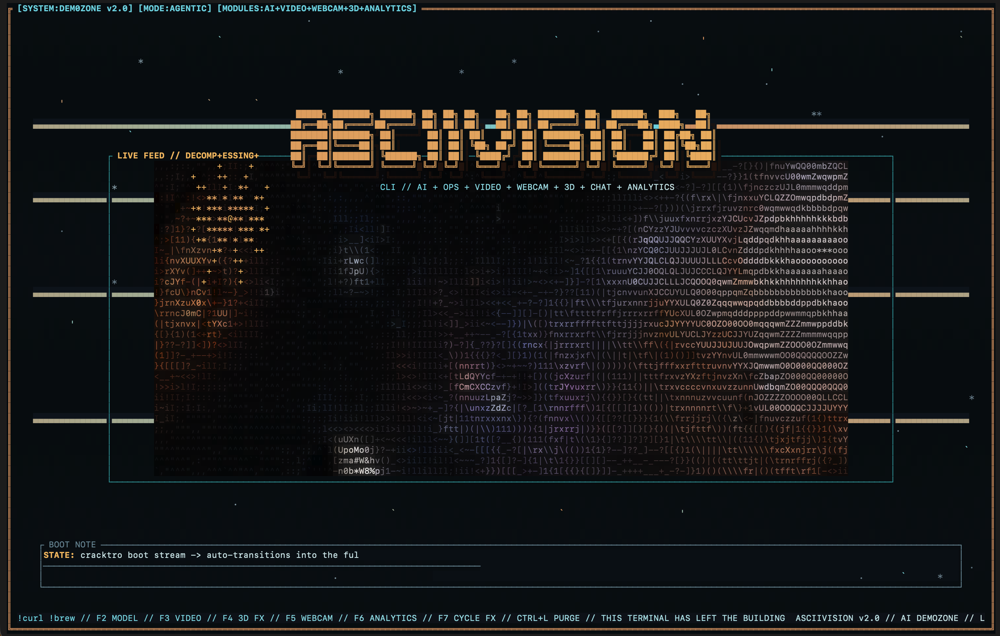

# ASCIIVision v2.0 -- All-In-One Terminal Powerhouse

> Agentic AI chat, live ASCII video, webcam streaming, WebSocket video chat, 3D terminal effects, Hyprland-style tiling, system monitoring, conversation analytics -- all in one terminal app.



---

## What Is This

ASCIIVision is a single Rust binary that packs an absurd amount of functionality into your terminal:

- **Multi-AI Chat** -- Claude Haiku 4.5, Grok 4 Fast, GPT-5 Nano, Gemini 3 Flash, and local Ollama models with live provider switching
- **Streaming Responses** -- AI responses appear character-by-character in real-time via SSE streaming (Claude, OpenAI, Grok), with seamless tool-use handoff mid-stream
- **Agentic Tool Use** -- AI can autonomously execute shell commands, read/write files, search codebases, make HTTP requests, and query system info with configurable approval gates
- **Shell Execution** -- run any bash command inline with `!<cmd>`, plus `/curl` and `/brew` shortcuts
- **ASCII Video Playback** -- MP4 files and streamed YouTube sources decoded to real-time colored ASCII art via FFmpeg
- **Live Webcam** -- your camera feed converted to ASCII art in real-time, with error reporting when the device is busy
- **WebSocket Video Chat** -- host or join multi-user live ASCII video chat rooms
- **3D Terminal Effects** -- rainbow matrix rain, plasma fields, 3D starfield, wireframe rotating cube, fire simulation, particle storms
- **Tiles Window** -- real PTY-backed embedded terminals for Codex, Claude, Gemini, shells, and any other CLI app, in 1-8 way grids
- **Hyprland-Style Tiling** -- move, swap, resize, and reassign panels with Ctrl+hjkl keybindings and 6 layout presets
- **Games Window** -- playable Pac-Man, Space Invaders, and 3D Penguin inside a focused tile with selector + WASD controls
- **System Monitor** -- live CPU, memory, swap, network I/O, load average, per-core sparklines
- **Conversation Analytics** -- real-time stats dashboard with message counts, provider breakdown, bar charts
- **Context Management** -- automatic summarization of older messages when the context window fills up, @-file injection, pinnable messages, persistent agent memory across sessions
- **SQLite Persistence** -- all conversations and agent memory saved to `~/.config/asciivision/conversations.db`
- **Cracktro Intro** -- animated boot sequence with starburst effects, raster bars, and scrolling ticker
- **Procedural Art in the Chat** -- 17 deterministic generators (fractals, cellular automata, L-system plants, strange attractors, mazes, flow fields, 3D solids and terrain) drawn straight into the transcript with per-cell color. Reachable via `/art`, `F12`, or the AI calling its own `generate_art` tool mid-conversation. No image models, no network: same seed, same art, every time.
- **Structural Themes** -- six named looks (`classic`, `blocks`, `braille`, `minimal`, `wireframe`, `depth3d`) that change glyph vocabulary, border treatment, video ramp, and how art is rasterized, not just the hues. `F11` cycles, `/theme <name>` picks, `F9` re-rolls colors within the current look, `F10` resets.
- **3D Render Mode** -- a shared rotation / perspective / z-buffer / Lambert-lighting engine drives both the animated Effects3D panel and the 3D art generators. Braille themes get 2x4 sub-cell resolution; the `depth3d` theme shades by depth.

Legacy companion apps (mega-cli, mega-analytics) are preserved in the `archive/` directory.

---

## Quick Start

### One-Line Install (Recommended)

The install script handles everything -- Rust, FFmpeg, LLVM, `yt-dlp`, Ollama, building, and adding `asciivision` to your PATH:

```bash
git clone https://github.com/lalomorales22/asciivision.git
cd asciivision
./install.sh
```

After installation, run from anywhere:

```bash
asciivision
```

The repo includes `demo-videos/demo.mp4` as the bundled intro/video sample, so the video bus works out of the box.

**Supported platforms:** macOS (Homebrew), Ubuntu/Debian, Fedora/RHEL, Arch Linux, openSUSE.
**Windows users:** Install [WSL2](https://learn.microsoft.com/en-us/windows/wsl/install) first (`wsl --install` in PowerShell), then run the commands above inside your WSL terminal.

### Manual Setup

If you prefer to install dependencies yourself:

#### Prerequisites

- **Rust** 1.70+ ([rustup.rs](https://rustup.rs))
- **FFmpeg 8.x** dev libraries -- the major version matters, see [FFmpeg version pinning](#ffmpeg-version-pinning)
- **LLVM/libclang** (needed to compile ffmpeg-sys-next)
- **pkg-config**
- **yt-dlp** (for `/youtube`)
- **Ollama** (for local model routing)

```bash
# macOS -- note ffmpeg@8, not plain ffmpeg
brew install ffmpeg@8 llvm pkg-config yt-dlp ollama

# Ubuntu/Debian
sudo apt install libavformat-dev libavcodec-dev libswscale-dev libavutil-dev libavdevice-dev pkg-config libclang-dev build-essential yt-dlp

# Fedora (enable RPM Fusion first)
sudo dnf install ffmpeg-devel clang-devel pkg-config gcc yt-dlp

# Arch
sudo pacman -S ffmpeg clang pkg-config base-devel yt-dlp

# Ollama (Linux / WSL2 manual install)
curl -fsSL https://ollama.com/install.sh | sh
```

#### FFmpeg version pinning

ASCIIVision builds against the **FFmpeg 8.x** ABI. This is pinned deliberately, in
two places that must agree:

| Where | Pin |
|---|---|
| `Cargo.toml` | `ffmpeg-next` / `ffmpeg-sys-next` `9.0` (these track FFmpeg 8.1) |
| macOS install | `ffmpeg@8` (keg-only), **not** plain `ffmpeg` |

Two separate things break if they drift apart:

1. **Build breakage.** `ffmpeg-next` matches exhaustively over FFmpeg's `AVCodecID`,
   `AVPacketSideDataType` and `AVFrameSideDataType` enums. A newer FFmpeg adds
   variants the crate has no arm for, so the build fails with `E0004:
   non-exhaustive patterns` *inside the crate itself*, before any project code
   compiles.
2. **Runtime breakage.** Homebrew's unversioned `/opt/homebrew/opt/ffmpeg` symlink
   repoints on `brew upgrade`. Linking against it means a future FFmpeg major bumps
   the dylib sonames (`libavutil.60` to `.61`) and an **already-installed** binary
   dies with a dyld "Library not loaded" error -- no rebuild needed to break it.
   The keg-only `ffmpeg@8` prefix never repoints, so the link stays valid.

`install.sh` and `./asciivision` both prepend the pinned keg to `PKG_CONFIG_PATH`
and verify the ABI before compiling, failing with a one-line explanation rather
than a wall of compiler errors.

**To move to a future FFmpeg major:** bump `ffmpeg-next` / `ffmpeg-sys-next` in
`Cargo.toml` to a release that supports it, then update `FFMPEG_BREW_FORMULA` and
`FFMPEG_LIBAVUTIL_MAJOR` at the top of `install.sh` and `asciivision` to match
(`libavutil` major 60 = FFmpeg 8.x, 59 = 7.x, 58 = 6.x).

#### Build & Run

```bash
# From the repo root (auto-builds + runs)
./asciivision

# Or manually
cargo build --release
./target/release/asciivision
```

### API Keys (Optional)

Copy `.env.example` to `.env` in the repo root and fill in your keys:

```bash
cp .env.example .env
```

Then edit `.env`:

```
CLAUDE_API_KEY=sk-ant-...
GROK_API_KEY=xai-...
OPENAI_API_KEY=sk-...
GEMINI_API_KEY=AIza...
```

Only the providers you want to use need keys. The app works without any keys -- shell, video, webcam, effects, tiling, sysmon, and local Ollama routing all work standalone.

---

## AI Models

| Provider | Model | Display Name |
|----------|-------|-------------|
| Anthropic | `claude-haiku-4-5` | Claude Haiku 4.5 |
| xAI | `grok-4-fast-non-reasoning` | Grok 4 Fast |
| OpenAI | `gpt-5-nano` | GPT-5 Nano |
| Google | `gemini-3-flash-preview` | Gemini 3 Flash |
| Ollama | installed models on this machine | Numbered local model picker |

Cycle between providers with F2 or `/provider <name>`. When you land on Ollama, ASCIIVision queries your local installed models and opens a numbered picker. Type the model number and press Enter to route chat into that model.

---

## CLI Flags

```
asciivision [OPTIONS]

Options:
  --provider <NAME>          AI provider: claude, grok, gpt, gemini, ollama [default: claude]
  --background-video <PATH>  MP4 file for the video panel
  --intro-video <PATH>       MP4 file for the intro sequence
  --skip-intro               Jump straight to the command deck
  --no-video                 Disable all video decoding
  --no-db                    Disable SQLite persistence
  --serve <PORT>             Start a WebSocket video chat server on this port
  --connect <URL>            Connect to a video chat server (ws://host:port)
  --username <NAME>          Username for video chat [default: anon]
  --webcam                   Enable webcam capture on startup
  --effects                  Start with 3D effects active
  --theme <NAME>             Start with a theme style: classic, blocks, braille, minimal, wireframe, depth3d
  --art <SPEC>               Render procedural art to stdout (24-bit color) and exit, e.g. --art "torus 7 --size 80x30"
```

`--art list` prints the generator catalogue. `--art` composes with `--theme`, so `asciivision --theme braille --art "mandelbrot 42"` is a quick way to preview a look without launching the TUI.

---

## Keyboard Controls

### Core

| Key | Action |
|-----|--------|
| `F1` | Help overlay |
| `F2` | Cycle AI provider (Claude, Grok, GPT-5, Gemini, Ollama) |
| `F3` | Toggle video panel |
| `F4` | Cycle 3D effects, then off, then repeat |
| `F5` | Toggle webcam capture |
| `F6` | Cycle tiling layout preset |
| `F7` | Boot/focus the Tiles PTY panel |
| `F8` | Cycle focused tile's panel type |
| `F9` | Randomize palette hues within the active theme style |
| `F10` | Reset theme to defaults (classic) |
| `F11` | Cycle theme style: classic → blocks → braille → minimal → wireframe → depth3d |
| `F12` | Drop a random piece of procedural art into the transcript |
| `Ctrl+L` | Clear transcript |
| `Ctrl+C` | Exit |
| `Esc` | Exit (if input empty) / Clear input (if typing) / Close help |
| `Tab` | Autocomplete a slash command (inserts spaces otherwise) |
| `PgUp/PgDn` | Scroll transcript |
| `Number + Enter` | Choose an Ollama model while the picker is open |

### Tiling (Hyprland-style)

| Key | Action |
|-----|--------|
| `Ctrl+h` | Focus tile to the left |
| `Ctrl+l` | Focus tile to the right |
| `Ctrl+k` | Focus tile above |
| `Ctrl+j` | Focus tile below |
| `Ctrl+H` | Swap focused tile left (Shift) |
| `Ctrl+L` | Swap focused tile right (Shift) |
| `Ctrl+K` | Swap focused tile up (Shift) |
| `Ctrl+J` | Swap focused tile down (Shift) |
| `Ctrl+[` | Shrink focused split |
| `Ctrl+]` | Grow focused split |
| `Ctrl+n` | Cycle focused tile to next panel type |

The focused tile is highlighted with the theme's primary border (double in `classic`, thick in `blocks`, rounded in `braille`, and so on).

On macOS, `F11`/`F12` may be captured by the system (Mission Control / Show Desktop). Hold `Fn`, remap them in System Settings, or use `/theme next` and `/art` instead.

---

## Slash Commands

| Command | Description |
|---------|-------------|
| `!<cmd>` | Execute shell command (e.g., `!ls -la`, `!git status`) |
| `/curl <args>` | Shortcut for curl |
| `/brew <args>` | Shortcut for brew |
| `/provider <name>` | Switch AI provider |
| `/ollama` | Switch to Ollama and open the local model picker |
| `/video` | Toggle video panel |
| `/video <path>` | Load any local video file into the video bus (aspect-correct, paced to the source frame rate) |
| `/youtube <url>` | Resolve and stream a YouTube video into the video panel using `yt-dlp` |
| `/webcam` | Toggle webcam |
| `/3d` or `/effects` | Toggle 3D effects |
| `/fx` | Cycle 3D effects, then off |
| `/analytics` | Show analytics in focused tile |
| `/games` | Show the games panel in the focused tile |
| `/games <pacman|space|penguin>` | Launch a specific game in the games panel |
| `/tiles` | Boot the Tiles panel with 2 live embedded terminals |
| `/tiles <1-8>` | Set the Tiles panel to a specific live terminal count |
| `/sysmon` | Show system monitor in focused tile |
| `/layout` | Cycle layout preset |
| `/layout <name>` | Set layout: default, dual, triple, quad, webcam, focus |
| `/server <port>` | Host a video chat room and join it yourself |
| `/connect <ip>:<port>` | Join a video chat room (`ws://` prefix optional); starts your webcam and streams it |
| `/chat <msg>` | Send message in video chat |
| `/username <name>` | Set your video chat username |
| `/clear` | Clear transcript |
| `/art` | Render random procedural art in the transcript |
| `/art <generator> [seed] [--seed N] [--size WxH]` | Render a specific generator, e.g. `/art mandelbrot 42`, `/art torus --size 60x24` |
| `/art list` | List the 17 generators |
| `/theme` or `/theme list` | List theme styles and mark the active one |
| `/theme <name>` | Switch style: classic, blocks, braille, minimal, wireframe, depth3d |
| `/theme next` | Cycle to the next style (same as F11) |
| `/randomize` or `/theme random` | Randomize palette hues within the active style |
| `/theme reset` | Restore the default classic theme |
| `/help` | Toggle help overlay (PgUp/PgDn scroll it, Esc closes) |

Type `/` and the first letters of a command to get an autocomplete popup: `Tab` or `Enter` fills in the highlighted entry, `Up`/`Down` move the highlight.

`./install.sh` installs [`yt-dlp`](https://github.com/yt-dlp/yt-dlp) and Ollama for you. If you do a manual setup, make sure both are installed and available before using `/youtube` or the Ollama provider.
`/youtube` now streams directly into the video bus by resolving a playable media URL first, so it no longer has to cache the full video before playback starts.
Ollama model selection is populated from the local machine at runtime. ASCIIVision does not assume any default model names; it lists whatever Ollama reports as installed on that system.

---

## Tiling Layout Presets

| Preset | Description |
|--------|-------------|
| **Default** | Transcript (55%) + Video/3D Effects side-by-side top, Webcam/Telemetry+SysMon/Ops stacked right |
| **Dual Pane** | Transcript (50%) + 3D Effects/Webcam/SysMon stacked right |
| **Triple Column** | Three columns: transcript, video+3D effects, webcam+sysmon+ops |
| **Quad** | 2x2-ish grid: transcript, video, 3D effects, webcam+sysmon |
| **Webcam Focus** | Webcam top-right, 3D Effects below it, transcript+sysmon left |
| **Full Focus** | Single full-screen transcript |

Every tile can be reassigned to any of 13 panel types: Transcript, Games, Tiles, Video, Webcam, Telemetry, Ops Deck, 3D Effects, Analytics, Video Chat Feeds, Video Chat Messages, Video Chat Users, or System Monitor.

---

## Games Window

Focus a tile and press `F8` or `Ctrl+n` until it becomes `GAMES`, or run `/games`.

- **Selection** -- `1`, `2`, `3`, arrow keys, or `WASD` choose between Pac-Man, Space Invaders, and 3D Penguin
- **Launch** -- `Enter` or `Space`
- **Play** -- `WASD` control the active game while the Games tile is focused and the input prompt is empty
- **Reset / Exit** -- `R` restarts the current game, `Esc` returns to the games selector

---

## Tiles Window

Focus a tile and press `F8` or `Ctrl+n` until it becomes `TILES`, press `F7`, or run `/tiles`.

- **Default Layout** -- `/tiles` boots 2 live terminals side-by-side
- **Custom Counts** -- `/tiles 4` creates a 2x2 shell grid, and any count from `1` to `8` is supported
- **Real PTYs** -- each inner tile is a real terminal session, so you can launch `codex`, `claude`, `gemini`, or any other CLI tool directly inside it
- **Inner Focus** -- `Ctrl+j/k` cycles between inner terminals (next/previous)
- **Outer Focus** -- `Ctrl+h/l` moves between ASCIIVision panels (left/right), so you can jump back to chat or another module

---

## Procedural Art

Art is generated in Rust from a seed, never downloaded and never produced by a model. The pipeline has three stages:

```
Generator ──► Scene ──► theme rasterizer ──► glyph cells
(seed, size)  (field / strokes / mesh)   (glyphs + per-cell color)
```

The theme decides what a scene *looks like*, so `/art mandelbrot 42` renders as a 69-step ASCII ramp under `classic`, as half-block pixels under `blocks`, as a 2x4 braille dot matrix under `braille`, and as a depth-shaded relief under `depth3d`.

| Generator | What it draws |
|-----------|---------------|
| `automaton` | 1D cellular automaton (rule 30 / 90 / 110 family) |
| `life` | Game of Life snapshot with fading trails |
| `noise` | Domain-warped fractal value noise |
| `mandelbrot` | Escape-time Mandelbrot zoom on a seed-chosen spot |
| `julia` | Escape-time Julia set |
| `maze` | Recursive-backtracker maze, rainbow by carve order |
| `attractor` | Clifford strange attractor density plot |
| `voronoi` | Voronoi cells with dark boundaries |
| `flow` | Particles traced through a noise flow field |
| `plant` | L-system plant (five rule sets) |
| `truchet` | Truchet arc tiles |
| `lissajous` | Lissajous / harmonograph curves |
| `cube`, `torus`, `sphere`, `icosahedron` | Rotating 3D solids: filled + lit under blocks/braille/depth3d, wireframe under classic/wireframe/minimal |
| `terrain` | 3D noise heightmap |

Three ways to make art:

1. `/art [generator] [seed] [--size WxH]` or `F12` for a random one.
2. Ask the AI. It has a `generate_art` tool and will call it on its own when a picture would help ("draw me a torus", "show me rule 110"). The tool is non-destructive, so it never prompts for approval. The model receives a short description plus a tiny monochrome thumbnail, never the full block, so the context window stays small.
3. `asciivision --art "<spec>"` on the command line.

Art blocks are static: one frame is rendered under the theme active at that moment, sized to the transcript's width, and committed to the history. Wide blocks are clipped on the right if the terminal is later shrunk; they are never re-wrapped. Animated 3D lives in the Effects3D panel (`F4` to the `THEME 3D SOLID` effect), which re-renders every frame under whatever theme is active.

---

## Themes

A theme is a render target, not just a palette. Each style bundles eleven colors with a glyph ramp, a border treatment, and an art rasterizer:

| Style | Glyphs | Borders | Feel |
|-------|--------|---------|------|
| `classic` | 69-step ASCII luminance ramp | double / plain | the original teal/amber look (default) |
| `blocks` | `▀▄` half-block pixels + `░▒▓█` | thick | neon poster, solid color fills |
| `braille` | U+2800..U+28FF, 2x4 dots per cell | rounded | highest fidelity, ice-blue/violet |
| `minimal` | `·:-=+*#` | plain | restrained two-tone mono |
| `wireframe` | `─│╱╲┼` box drawing | double / plain | phosphor-green CAD |
| `depth3d` | ramp indexed by lighting, color by depth | quadrant blocks | sunset palette, relief shading |

The style also drives the video and webcam ASCII ramp, so switching to `blocks` restyles the live video bus too. `F9` and `/theme random` re-roll the hues *within* the current style; `F11` or `/theme <name>` changes the style itself.

---

## 3D Effects

Seven terminal-rendered visual effects, cycled with `F4` or `/fx`, then turned off on the next cycle:

1. **Rainbow Matrix Rain** -- cascading characters with per-column rainbow hues that drift over time, white head glow, color-tinted backgrounds
2. **Plasma Field** -- RGB sine-wave interference patterns with smooth color cycling
3. **3D Starfield** -- perspective-projected stars flying toward the camera with depth-based brightness
4. **Wireframe 3D** -- rotating cube rendered with ASCII line-drawing and labeled vertices
5. **Fire Simulation** -- bottom-up flame propagation with heat diffusion and ember colors
6. **Particle Storm** -- multi-colored particles exploding from center with gravity and fade
7. **Theme 3D Solid** -- a torus, icosahedron, cube, sphere and terrain take turns rotating, rendered through the art pipeline so they are filled and lit under `blocks`/`braille`/`depth3d` and wireframe under `classic`/`wireframe`/`minimal`

The wireframe cube and the art generators share one 3D implementation in `src/art/render3d.rs` (rotation, perspective with depth, terminal cell-aspect correction, z-buffer, Lambert shading).

---

## System Monitor

Live system telemetry panel (powered by `sysinfo`) showing:

- **CPU** -- global usage percentage with colored bar and per-core sparkline
- **Memory** -- used/total with bar graph, color-coded thresholds
- **Swap** -- usage with bar (if swap is active)
- **Network** -- upload/download bytes with arrow indicators
- **Load Average** -- 1/5/15 minute load
- **Cores** -- thread count

Thresholds: green (<50%), amber (50-80%), red (>80%) for CPU and memory.

---

## Webcam

Live camera capture converted to ASCII art using FFmpeg's AVFoundation (macOS), V4L2 (Linux), or DirectShow (Windows).

- Toggle with F5 or `/webcam`
- If another app (OBS, Zoom, FaceTime) has the camera locked, the panel shows a red error message explaining the conflict and how to fix it
- The capture thread is crash-safe (wrapped in `catch_unwind`) so a webcam failure never takes down the app
- Camera errors are surfaced in both the webcam panel and the status ticker

---

## WebSocket Video Chat

`/server 8000` hosts a room on all interfaces and joins it as you. Anyone on the network runs `/connect 192.168.1.20:8000`. Both sides get their webcam started automatically and every participant's camera is encoded as colored ASCII and streamed over the socket; the feeds panel tiles up to four participants with your own camera as the last tile.

Host a server and connect clients for multi-user live ASCII webcam streaming in the terminal.

```bash
# Machine A: host the server
asciivision --serve 8080

# Machine B: connect as a client
asciivision --connect ws://192.168.1.100:8080 --username alice --webcam
```

Or use slash commands at runtime:
```
/server 8080
/connect ws://192.168.1.100:8080
/chat hello everyone
```

The video chat panel shows up to 4 remote feeds in a grid, a chat stream, and a connected users list.

---

## Project Structure

```
asciivision/
├── install.sh           # One-line installer (deps + build + PATH setup)
├── asciivision          # Launcher script (builds + runs)
├── Cargo.toml           # Main crate dependencies
├── .env.example         # API key template (copy to .env)
├── src/
│   ├── main.rs          # App shell: modes, rendering, input dispatch, tiling integration
│   ├── ai.rs            # Multi-provider AI client with streaming (Claude, Grok, GPT-5, Gemini, Ollama)
│   ├── tools.rs         # Agentic tool definitions and execution (shell, files, search, HTTP, sysinfo, generate_art)
│   ├── memory.rs        # Persistent agent memory (SQLite-backed key-value store)
│   ├── video.rs         # FFmpeg-based MP4 to ASCII art decoder
│   ├── webcam.rs        # Live webcam capture with ASCII conversion + error reporting
│   ├── shell.rs         # Async shell command execution with timeout
│   ├── db.rs            # SQLite conversation persistence
│   ├── tiling.rs        # Binary-tree tiling window manager with 6 presets + min-size enforcement
│   ├── theme.rs         # Theme engine: 6 structural styles (glyph ramp, borders, palette) + HSL randomization
│   ├── art/
│   │   ├── mod.rs       # Scene IR, Generator catalogue, ArtSpec parsing, ArtBlock (rendered cells)
│   │   ├── generators.rs# 17 deterministic generators (fields, strokes, meshes)
│   │   ├── raster.rs    # Sub-cell Raster + per-style rasterizers (braille, half-block, ramp, box-drawing, depth)
│   │   ├── render3d.rs  # Shared 3D: rotate/project/z-buffer/lighting + cube/torus/sphere/icosahedron/terrain
│   │   └── rng.rs       # splitmix64 PRNG + value noise / fBm (seed-deterministic)
│   ├── sysmon.rs        # System monitor (CPU, memory, network, load)
│   ├── effects.rs       # 3D terminal effects engine (7 effects, rainbow matrix, theme solid)
│   ├── analytics.rs     # Conversation analytics dashboard with bar charts
│   ├── server.rs        # WebSocket video chat server (multi-user broadcast)
│   ├── client.rs        # WebSocket video chat client (webcam + chat)
│   └── message.rs       # WebSocket protocol message types
├── archive/
│   ├── mega-cli/        # Legacy standalone multi-AI chat app
│   └── mega-analytics/  # Legacy standalone analytics dashboard
└── demo-videos/         # Bundled sample video (`demo.mp4`) for intro/video playback
```

---

## Dependencies

| Category | Crates |
|----------|--------|
| Core | `ratatui`, `crossterm`, `tachyonfx`, `tokio`, `clap`, `anyhow` |
| Video | `ffmpeg-next`, `ffmpeg-sys-next`, `crossbeam-channel` |
| AI | `reqwest`, `serde`, `serde_json`, `dotenvy` |
| Networking | `tokio-tungstenite`, `futures`, `parking_lot`, `uuid` |
| System | `sysinfo`, `rusqlite`, `chrono`, `rand` |

---

## Requirements

- macOS, Linux, or Windows (via WSL2)
- Terminal with RGB color support (iTerm2, Kitty, Alacritty, WezTerm, etc.)
- A webcam (optional, for webcam/video chat features)
- Only one app can use the webcam at a time on macOS -- close OBS/Zoom/FaceTime before enabling webcam capture

All build dependencies and local-media extras (Rust, FFmpeg, LLVM, `yt-dlp`, Ollama) are installed automatically by `./install.sh`.
